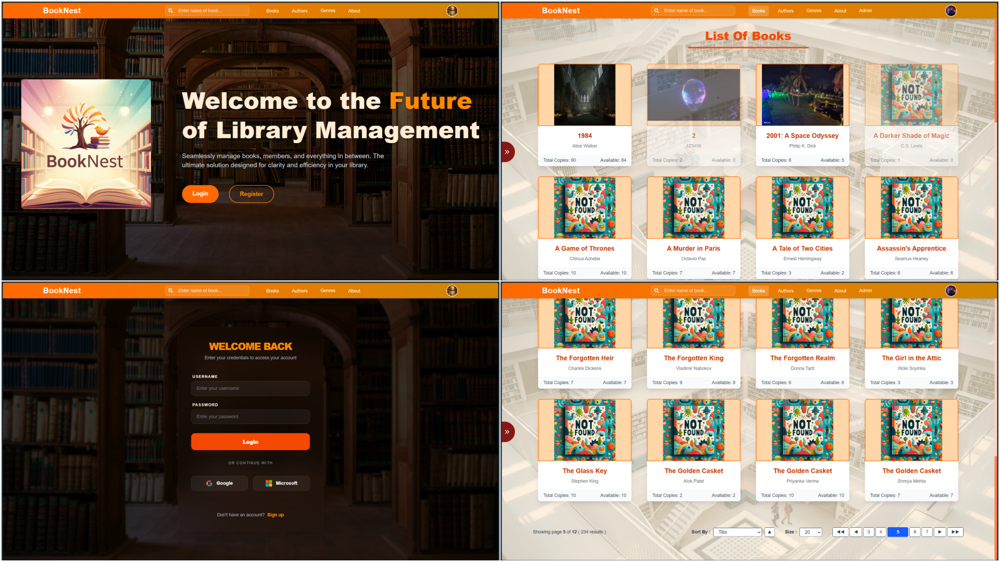
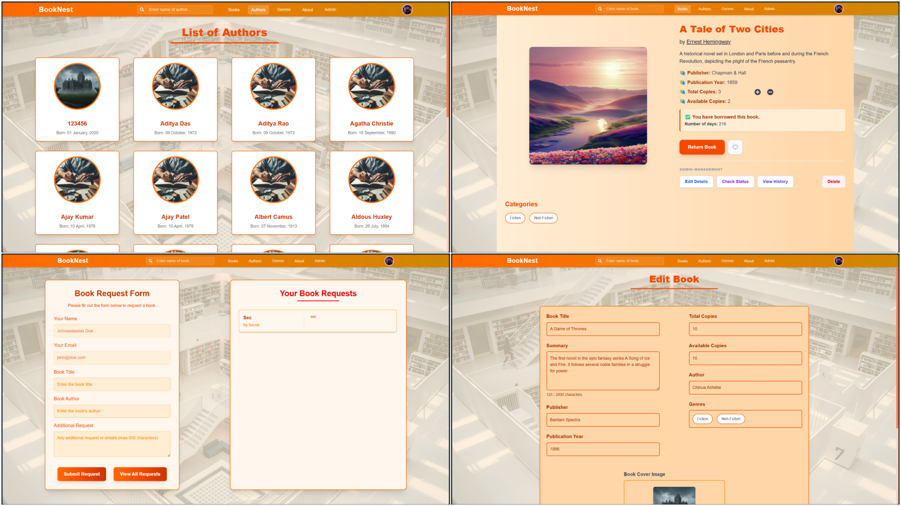
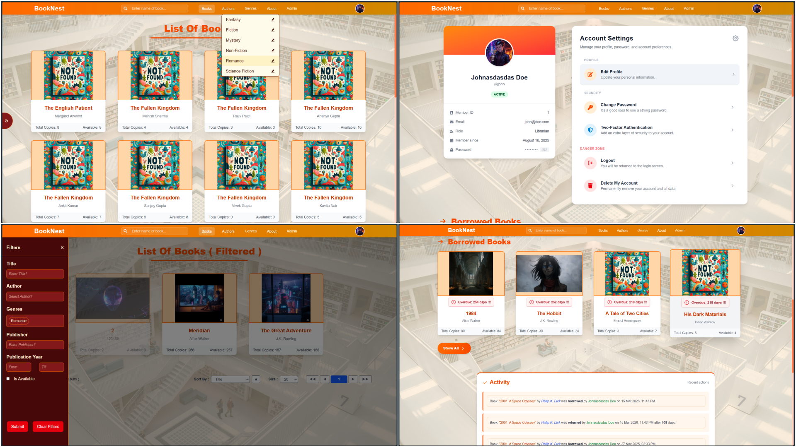

# 📚 Library Management System (LMS)

A comprehensive, full-stack library management solution featuring a Spring Boot REST API and a modern React frontend. This system handles book inventory, member registrations, borrowing workflows, and automated profile and cover image management.





## 🚀 Features

### Authentication & Security

- JWT-based stateless authentication with token refresh mechanisms
- OAuth2 Social Login integration for third-party providers
- Role-Based Access Control (RBAC) with distinct permissions for Librarians and Members
- Secure password hashing and validation

### Inventory Management

- Full CRUD operations for Books, Authors, and Genres
- Dynamic categorization and tagging system
- Stock level tracking and availability management
- Author profile management with biographical information

### Borrowing System

- Comprehensive tracking of borrowed books with due dates
- Borrowing history for members and audit trails
- Available stock level monitoring and reservations

### Book Requests

- Member-initiated requests for new titles
- Librarian dashboard for managing and fulfilling requests
- Request status tracking and approval workflows

### File Storage & Media Management

- Structured local storage for Author photographs
- Book cover image management with optimization
- Member avatar and profile image uploads
- Dynamic directory organization by entity type and ID

### Advanced Filtering & Pagination

- Server-side pagination with configurable page sizes
- Multi-criteria sorting capabilities
- Advanced filtering by genre, author, availability, and publication date
- Search functionality with partial matching and relevance scoring

### Personalized User Features

- Wishlist management for members
- Borrowing history with analytics
- Personalized recommendations based on borrowing patterns
- Reading progress tracking

## 🛠️ Tech Stack

### Backend

| Component                | Technology                            | Purpose                                          |
| ------------------------ | ------------------------------------- | ------------------------------------------------ |
| **Framework**            | Java 21, Spring Boot 3.4.3            | Core application framework                       |
| **Security**             | Spring Security, JJWT, OAuth2 Client  | Authentication and authorization                 |
| **Data Access**          | Spring Data JPA, PostgreSQL           | Object-relational mapping and database           |
| **Object Mapping**       | ModelMapper                           | Entity to DTO conversion                         |
| **Additional Libraries** | Lombok, Spring AOP, Spring Validation | Boilerplate reduction and cross-cutting concerns |

### Frontend

| Component            | Technology                           | Purpose                       |
| -------------------- | ------------------------------------ | ----------------------------- |
| **Framework**        | React 18 with Vite                   | Modern UI development         |
| **State Management** | Redux Toolkit (authSlice, bookSlice) | Centralized application state |
| **Styling**          | Tailwind CSS                         | Utility-first CSS framework   |
| **Routing**          | React Router DOM                     | Client-side navigation        |
| **HTTP Client**      | Axios                                | API communication             |

## 📂 Project Structure

```
library-management-system/
├── backend/                          # Spring Boot Maven Project
│   ├── images/                       # Local storage for file uploads
│   │   ├── authors/
│   │   ├── books/
│   │   └── members/
│   ├── sql-scripts/                  # Database initialization and seed data
│   ├── src/main/java/
│   │   ├── com/lms/
│   │   │   ├── config/              # Spring configuration classes
│   │   │   ├── controller/          # REST API endpoints
│   │   │   ├── service/             # Business logic layer
│   │   │   ├── repository/          # Data access layer (Spring Data JPA)
│   │   │   ├── entity/              # JPA entities
│   │   │   ├── dto/                 # Data Transfer Objects
│   │   │   ├── security/            # JWT and OAuth2 configuration
│   │   │   ├── exception/           # Custom exception classes
│   │   │   └── util/                # Utility classes
│   │   └── resources/
│   │       ├── application.yaml      # Spring Boot configuration
│   │       └── application-*.yaml    # Environment-specific configs
│   └── pom.xml                       # Maven dependencies
│
└── frontend/                         # React + Vite Project
    ├── public/                       # Static assets
    ├── src/
    │   ├── app/
    │   │   ├── features/            # Redux slices and reducers
    │   │   │   ├── authSlice.js
    │   │   │   ├── bookSlice.js
    │   │   │   └── ...
    │   │   ├── store.js             # Redux store configuration
    │   │   └── hooks/               # Custom Redux hooks
    │   ├── components/              # Reusable React components
    │   │   ├── common/              # Common UI components (Nav, Footer)
    │   │   ├── modals/              # Modal dialogs
    │   │   └── cards/               # Data display cards
    │   ├── pages/                   # Page-level components
    │   ├── services/                # API service layer with Axios
    │   │   └── api.js               # Centralized API configuration
    │   ├── styles/                  # Global styles and Tailwind config
    │   ├── App.jsx                  # Root application component
    │   └── main.jsx                 # Vite entry point
    ├── index.html                   # HTML template
    ├── vite.config.js               # Vite configuration
    ├── package.json                 # npm dependencies
    └── tailwind.config.js            # Tailwind CSS configuration
```

## ⚙️ Getting Started

### Prerequisites

Before setting up the project, ensure you have the following installed on your system:

- **JDK 21** or higher
- **Node.js** v18 or higher with npm package manager
- **PostgreSQL** 12 or higher for database management
- **Git** for version control

### Backend Setup

Follow these steps to configure and run the Spring Boot backend application:

1. Navigate to the backend directory:

   ```bash
   cd backend
   ```

2. Update the database configuration in `src/main/resources/application.yaml` with your PostgreSQL credentials and connection details:

   ```yaml
   spring:
     datasource:
       url: jdbc:postgresql://localhost:5432/lms_db
       username: your_postgres_user
       password: your_postgres_password
   ```

3. Create the PostgreSQL database and initialize the schema using the provided SQL scripts:

   ```bash
   psql -U your_postgres_user -d postgres -f sql-scripts/init-db.sql
   ```

4. Start the Spring Boot application using Maven:

   ```bash
   ./mvnw spring-boot:run
   ```

   The backend will be accessible at `http://localhost:8080`

### Frontend Setup

Follow these steps to set up and run the React frontend application:

1. Navigate to the frontend directory:

   ```bash
   cd frontend
   ```

2. Install all Node.js dependencies as specified in package.json:

   ```bash
   npm install
   ```

3. Configure the API endpoint in your environment variables. Create a `.env` file in the frontend root directory:

   ```
   VITE_API_URL=http://localhost:8080/api
   ```

4. Start the Vite development server:

   ```bash
   npm run dev
   ```

   The frontend will be available at `http://localhost:5173`

## 🔗 API Endpoints (Quick Reference)

| HTTP Method | Endpoint                  | Access Level     | Description                                                    |
| ----------- | ------------------------- | ---------------- | -------------------------------------------------------------- |
| `POST`      | `/api/auth/register`      | Public           | Create a new member account with email and password            |
| `POST`      | `/api/auth/login`         | Public           | Authenticate user and obtain JWT token for session             |
| `GET`       | `/api/books`              | Member/Librarian | Retrieve books with filtering, pagination, and sorting options |
| `GET`       | `/api/books/{id}`         | Member/Librarian | Retrieve detailed information for a specific book              |
| `POST`      | `/api/books`              | Librarian        | Create new book entry with cover image upload                  |
| `PUT`       | `/api/books/{id}`         | Librarian        | Update existing book information and metadata                  |
| `DELETE`    | `/api/books/{id}`         | Librarian        | Remove book from inventory                                     |
| `POST`      | `/api/borrow`             | Member/Librarian | Create a borrowing record with due date calculation            |
| `GET`       | `/api/borrow/history`     | Member/Librarian | Retrieve borrowing history with status filtering               |
| `PATCH`     | `/api/borrow/{id}/return` | Member/Librarian | Mark borrowed book as returned                                 |
| `POST`      | `/api/bookRequest`        | Member           | Submit request for new book addition                           |
| `GET`       | `/api/bookRequest`        | Librarian        | Retrieve pending book requests                                 |
| `PATCH`     | `/api/bookRequest/{id}`   | Librarian        | Update book request status and mark as completed               |
| `GET`       | `/api/authors`            | Member/Librarian | List all authors with pagination                               |
| `POST`      | `/api/authors`            | Librarian        | Add new author with profile photo                              |
| `GET`       | `/api/genres`             | Member/Librarian | Retrieve all available genres                                  |
| `POST`      | `/api/genres`             | Librarian        | Create new genre category                                      |
| `POST`      | `/api/wishlist/{bookId}`  | Member           | Add book to personal wishlist                                  |
| `GET`       | `/api/wishlist`           | Member           | Retrieve member's wishlist items                               |

### Authentication

All protected endpoints require a valid JWT token in the Authorization header:

```
Authorization: Bearer <your_jwt_token>
```

## 🖼️ Media Management

The system employs a dynamic directory structure for organizing uploaded images to prevent filename collisions and maintain clean filesystem organization across different entity types.

### Directory Structure

The media storage follows this organizational pattern:

```
images/
├── authors/
│   └── {authorId}/
│       ├── profile.jpg
│       └── profile-thumbnail.jpg
├── books/
│   └── {bookId}/
│       ├── cover.jpg
│       └── cover-thumbnail.jpg
└── members/
    └── {memberId}/
        ├── avatar.jpg
        └── avatar-thumbnail.jpg
```

### Image Management Best Practices

- **File Upload**: Images are processed server-side to generate thumbnails for optimized loading
- **Storage Location**: All uploads are stored in the `/images` directory relative to the application root
- **File Naming**: Files are organized by entity type and ID to ensure unique paths
- **Cleanup**: Implement scheduled tasks to remove orphaned images when entities are deleted
- **Validation**: Image uploads are validated for file type (JPEG, PNG) and size constraints

## 📋 Database Schema Overview

The system uses PostgreSQL with the following primary entities:

### Core Entities

- **Users**: Member and Librarian accounts with authentication details
- **Authors**: Author information with biographical details and profile images
- **Books**: Book inventory with genre associations and availability tracking
- **Genres**: Book categorization system
- **Borrowing Records**: Transaction history with dates and status tracking
- **Book Requests**: Member requests for new titles with approval workflow
- **Wishlist**: User's saved books for future borrowing

## 🔐 Security Considerations

- Passwords are hashed using Spring Security's bcrypt encoder
- JWT tokens include expiration time and refresh token mechanism
- OAuth2 integration supports secure third-party authentication
- Role-based access control ensures proper permission enforcement
- CORS configuration is implemented for frontend-backend communication
- SQL injection prevention through parameterized queries (Spring Data JPA)
- CSRF protection for state-changing operations

## 📝 License

This project is distributed under the MIT License. See the `LICENSE` file for complete licensing information and terms of use.

## 🤝 Contributing

Contributions are welcome. Please ensure adherence to existing code style and add appropriate documentation for new features.

## 📞 Support

For issues, questions, or suggestions, please open an issue in the project repository or contact the development team (Me 😊).
